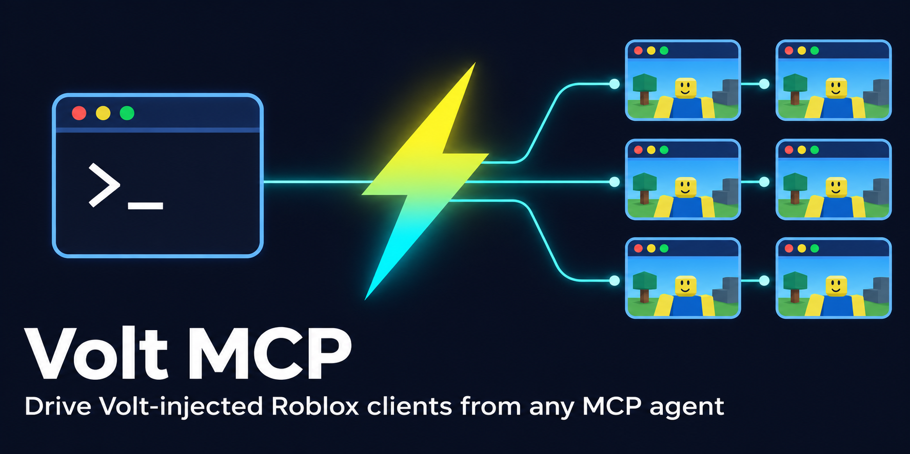
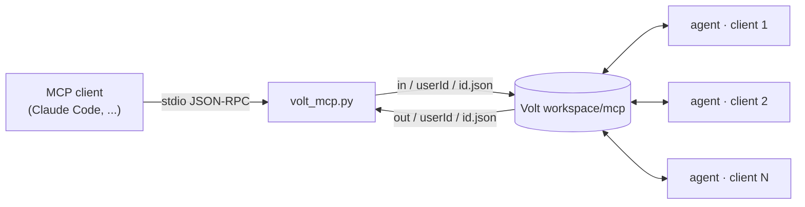

<p align="center">
  
</p>

<h1 align="center">Volt MCP</h1>

<p align="center">
  An unofficial <a href="https://modelcontextprotocol.io">Model Context Protocol</a> server for the Volt executor.<br>
  Run Luau in your injected Roblox clients, read values back, and tail the console from Claude Code or any MCP client.
</p>

<p align="center">
  <a href="https://github.com/nookkungz/volt-mcp/actions/workflows/selftest.yml"></a>
  
  
  
  <a href="LICENSE"></a>
</p>

---

Volt ships no MCP server and no public API for running scripts from outside. Volt MCP fills that gap with two small files: a Python server that speaks MCP, and a Luau agent that Volt auto-executes in every client. They talk through plain files in Volt's `workspace` folder, so there is no socket to open, no token to handle, and nothing to break when Volt updates its internals.

## Features

- **Five tools**: `list-clients`, `set-active-client`, `eval`, `execute`, `get-console-output`.
- **Many clients at once.** Every call takes an optional `client` (username or userId), so an agent can query all windows in parallel without switching an "active" one.
- **Real return values.** Tables, multiple returns, Instances (as full names) and Roblox datatypes all come back as JSON.
- **Console capture that works on Volt.** Volt routes an executor script's `print`/`warn` to its own console instead of `LogService`; the agent records both.
- **Zero dependencies.** One Python file, standard library only. One Luau file.
- **Survives teleports.** The agent restarts with each injection and reconnects on its own.

## How it works



1. Volt's autoexec starts `volt-mcp-agent.luau` in each client it injects.
2. Each agent writes a heartbeat to `mcp/clients/<userId>.json` every 2 seconds and polls its inbox `mcp/in/<userId>/`.
3. A tool call becomes one command file. The agent runs it and writes the result to `mcp/out/<userId>/`.
4. The server returns that result to the MCP client. Each message is handled on its own thread, so a slow client never blocks a call to another.

## Quick start

**Requirements:** Windows, Volt with autoexec enabled, Python 3.8 or newer.

**1. Get the files**

```powershell
git clone https://github.com/nookkungz/volt-mcp.git
cd volt-mcp
```

**2. Install the agent into Volt's autoexec**

```powershell
Copy-Item volt-mcp-agent.luau "$env:LOCALAPPDATA\Volt\autoexec\"
```

**3. Register the server with your MCP client**

Claude Code:

```powershell
claude mcp add --scope user volt -- python "C:\path\to\volt-mcp\volt_mcp.py"
```

Any other client (JSON config):

```json
{
  "mcpServers": {
    "volt": {
      "command": "python",
      "args": ["C:\\path\\to\\volt-mcp\\volt_mcp.py"]
    }
  }
}
```

**4. Launch or relaunch your clients.** A window that was injected before step 2 picks the agent up on its next teleport or relaunch. Then ask your agent to call `list-clients`.

## Tools

| Tool | Arguments | What it does |
|---|---|---|
| `list-clients` | none | Lists connected clients: userId, username, place, job, heartbeat age. |
| `set-active-client` | `clientId` | Sets the default target for calls that pass no `client`. |
| `eval` | `expression`, `timeout?`, `maxOutputChars?`, `client?` | Runs Luau and returns its value. An expression (`1+1`) or a block ending in `return` both work. Lines printed during the run come back as `output`. |
| `execute` | `code`, `client?` | Schedules Luau and returns at once, for code that keeps running. An error in the first 0.4 s is reported. |
| `get-console-output` | `limit?`, `client?` | Returns the latest console lines (`print`, `info`, `warn`, `error`); the agent keeps the last 500. |

With one client connected, `client` can be left out. With several, pass `client` or call `set-active-client` first.

### Example

```text
> eval  client="PlayerOne"
        expression="local t = {} for _, p in ipairs(game.Players:GetPlayers()) do table.insert(t, p.Name) end return { place = game.PlaceId, players = t }"

{
  "value": { "place": 1234567890, "players": ["PlayerOne", "PlayerTwo"] },
  "output": []
}
```

### Use it from Python

The server module doubles as a small library:

```python
import volt_mcp

print(volt_mcp.clients())
print(volt_mcp.call("eval", {"expression": "game.PlaceId", "client": "PlayerOne"}))
```

## Configuration

| Setting | Default | Purpose |
|---|---|---|
| `VOLT_WORKSPACE` (environment variable) | `%LOCALAPPDATA%\Volt\workspace` | Folder the server exchanges files in. |
| `eval` → `timeout` | 15000 ms (1000 to 120000) | How long to wait for a client's answer. |
| `eval` → `maxOutputChars` | 20000 | Cap on the text returned to the model. |

A client counts as connected while its heartbeat is at most 20 seconds old. Commands older than 120 seconds are dropped by the agent instead of run late.

## Testing

```powershell
python volt_mcp.py --selftest
```

This runs the server against a stand-in agent that follows the same file protocol: tool listing, targeting rules, parallel clients, errors, timeouts and output truncation. It needs no Volt install and runs in CI on Windows and Linux.

## Security

- The agent runs **any code written into `workspace/mcp/in/`**. Anything that can write to that folder controls your clients. Keep it on a machine only you use, and do not sync or share that folder.
- Everything stays local. The server opens no network port and sends nothing off the machine.
- Text that comes back from a game (chat, names, console lines) is untrusted data. The server tells MCP clients to treat it as data, not instructions.

## Limitations

- Polling adds latency: about 0.25 s per call, more when a window runs at a very low frame rate.
- Not included: remote spy, decompiler, script search, screenshots, background jobs.
- The executor must provide `readfile`, `writefile`, `listfiles`, `delfile`, `isfolder`, `makefolder`, `loadstring` and `getgenv`. Only Volt is tested.

## Disclaimer

This is an unofficial community project. It is not affiliated with or endorsed by Volt or Roblox. Using a script executor breaks the Roblox Terms of Use and can get accounts banned. Use it at your own risk and only on accounts you own.

## License

[MIT](LICENSE)
